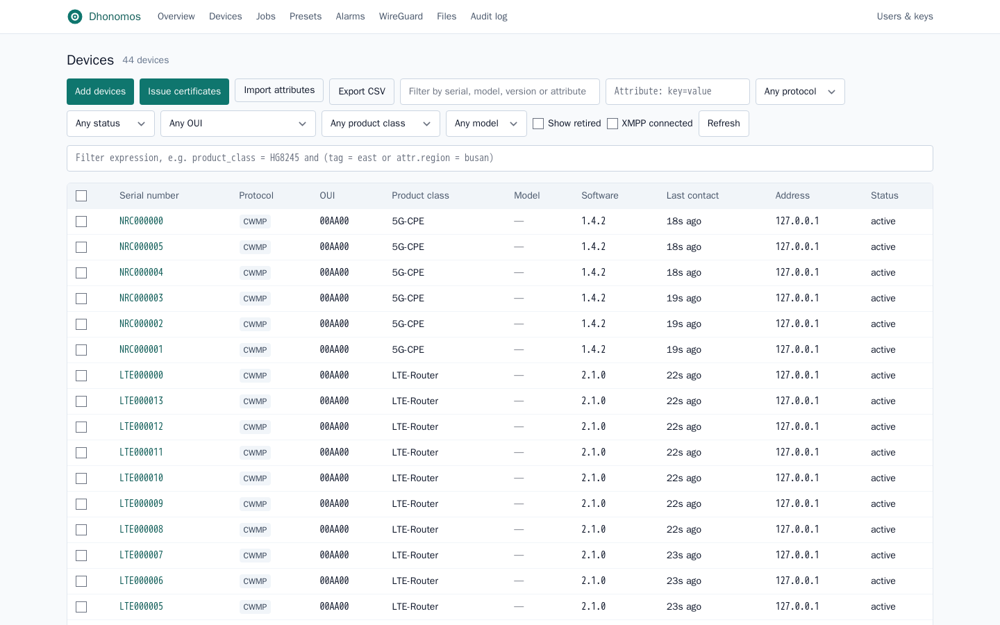
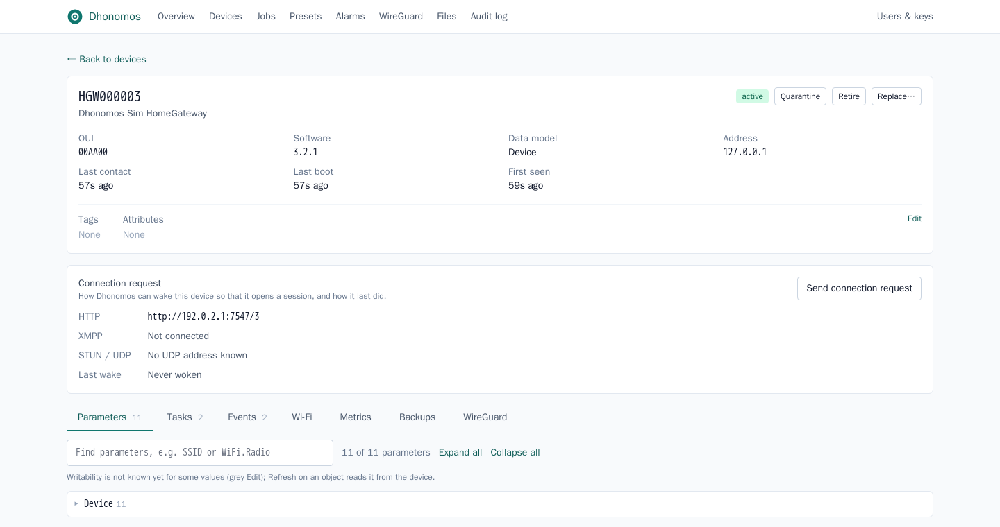
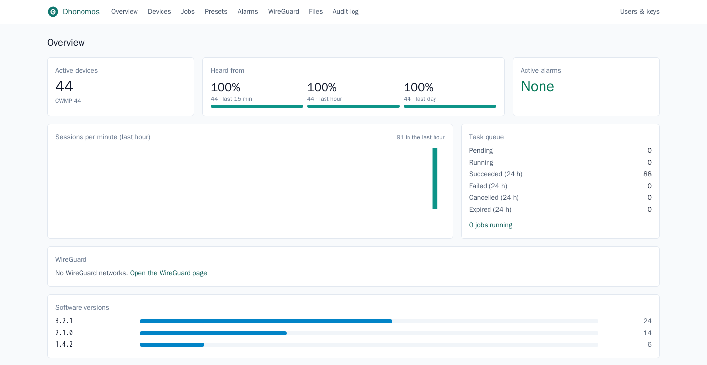

# Dhonomos

A TR-069 (CWMP) ACS and a TR-369 (USP) Controller in one Rust binary.

Dhonomos manages customer premises equipment (home gateways, routers, LTE/5G CPEs) for
ISPs with thousands to tens of thousands of devices. It needs one executable (`dhonomos`) and
PostgreSQL. Licensed under Apache-2.0.



<details>
<summary>More screenshots</summary>




</details>

The screenshots show simulated devices (`crates/simulator`).

## The name

**Dhonomos** = **DH** + **Oikonomos**. DH: the initials of its author, Donghyun.
The Greek *oikonómos* (οἰκονόμος) is the manager of a household (*oikos*, house), a steward.
It is also the root of the word *economy*.
Dhonomos is a server that looks after the devices in subscribers' homes.

## Features

- **CWMP ACS**
  - TR-069 Amendment 6 sessions (CWMP 1.0-1.4), TLS, Digest/Basic auth.
  - Per-device ACS credentials bound to their device; blocking of sources with repeated auth failures.
  - Zero-touch onboarding with policies (auto, quarantine, pre-registered, OUI allow-list).
  - Connection Requests over HTTP, UDP (built-in STUN) and XMPP (built-in XMPP server, for CPEs behind NAT/CGNAT).
  - Built-in file server for firmware and configuration files (signed links, bandwidth limits).
- **USP Controller**
  - MTPs: MQTT 5 (external broker or the built-in broker), WebSocket (both directions), STOMP 1.2 (built-in broker).
  - Own CA and Agent certificates (issue, expiry list, revocation), per-Agent broker accounts.
  - Supported data model cache, subscriptions, Operate, firmware images.
- **Provisioning and operations**
  - Task queue with retries; presets (YAML or UI) and sandboxed [Rune](https://rune-rs.github.io/) provisioning scripts.
  - Bulk jobs and firmware campaigns (canary stages, automatic pause, version check).
  - Diagnostics with one result format for CWMP and USP (ping, traceroute, DNS, TR-143, Wi-Fi neighbours).
  - Time series from BulkData, alarms (rules, silences, webhooks, e-mail).
  - Configuration backup, drift, restore and device replacement.
  - WireGuard tunnels to devices, with an optional hub (`dhonomos-wg-hub`).
- **Northbound and security**
  - REST API with an OpenAPI 3.1 document (`/api/v1/openapi.json`), server-sent events, CSV export.
  - Web UI (SvelteKit), embedded in the binary.
  - Accounts, roles, API keys, device scopes per team, OpenID Connect SSO, TOTP two-factor auth, audit log.
- **Deployment**
  - Prometheus metrics, OpenTelemetry traces, config reload on SIGHUP, data retention.
  - Static binary in a `scratch` container image (about 22 MB), Docker Compose files.

Measured: 50,000 simulated CPEs, 2,000 periodic Informs/s, 113 MB of memory, no errors, with a
larger database pool and session limit than the defaults (`--database-max-connections 96
--acs-max-concurrent 4096`; [docs/perf/README.md](docs/perf/README.md), Korean).

See [CHANGELOG.md](CHANGELOG.md) for the full list.

## Status

Pre-1.0, in testing. There are no releases yet: build from source.
Command-line flags, the API and the database schema can still change.
Tested in a lab with OpenWrt-based CPEs (CWMP and USP) and with simulators.
There has been no external security review yet; only internal reviews. Please report problems as
described in [SECURITY.md](SECURITY.md).

## Building

### Requirements

- Linux on x86_64 (other platforms are untested).
- Rust: [rustup](https://rustup.rs/) installs the pinned toolchain from `rust-toolchain.toml`
  (1.99) on the first `cargo` call. Minimum supported Rust version: 1.96.
- Docker: builds the web UI (in a Node container), builds the container image, and runs
  the integration tests.

Not needed: `protoc` (protobuf is compiled in pure Rust), a database at build time
(SQL queries are checked against the offline data in `.sqlx/`).

### Container image (recommended)

```bash
git clone https://github.com/pdh0085/dhonomos.git && cd dhonomos
docker build -t dhonomos:dev .   # the tag deploy/docker-compose.yml uses
```

The image holds one statically linked binary (musl) with the web UI inside, on an empty
(`scratch`) base.

### From source

```bash
scripts/build-ui.sh                      # web UI -> ui/build (runs npm in a Node container)
cargo build --release -p dhonomos        # server -> target/release/dhonomos
cargo build --release -p dhonomos-wg-hub # optional WireGuard hub -> target/release/dhonomos-wg-hub
```

Build the UI first: release builds embed `ui/build` in the binary.
Debug builds read `ui/build` from disk at run time.
`cargo build` on a glibc host gives a dynamically linked binary; for a static one, use the
Dockerfile (Alpine, musl).

## Quick start

```bash
cp deploy/dhonomos.env.example deploy/dhonomos.env   # fill in the secrets (openssl rand -base64 32),
                                                     # DHONOMOS_CPE_USERNAME/PASSWORD and the ACS TLS cert
docker compose -f deploy/docker-compose.yml up -d
```

- Web UI: `http://127.0.0.1:8080`, user `admin`, password from the env file.
  The admin account must set up two-factor auth at the first login.
  Step by step: [docs/guide/install.en.md](docs/guide/install.en.md).
- The API and UI have no TLS of their own: put them behind a TLS reverse proxy before
  opening them to other hosts.
- CPEs: set the ACS URL to `https://<server>:7547/`. The ACS does not start without a TLS
  certificate (`DHONOMOS_ACS_TLS_CERT`, `DHONOMOS_ACS_TLS_KEY`) or `DHONOMOS_ACS_PLAINTEXT=true`
  (plain HTTP, isolated labs only), and without CPE credentials (`DHONOMOS_CPE_USERNAME`,
  `DHONOMOS_CPE_PASSWORD`) or `DHONOMOS_CPE_AUTH=none` (labs only).
- USP over MQTT with Mosquitto: add `--profile usp`.

Ports in the compose file: 7547/tcp ACS, 7548/tcp file server, 8080/tcp API and UI (loopback only).
Off by default, turned on by an option: USP WebSocket (`--usp-ws-listen`, e.g. 7549/tcp),
STUN (`--stun-listen`, e.g. 3478/udp), XMPP (`--xmpp-listen`, e.g. 5222/tcp), the built-in
MQTT and STOMP brokers.

`dhonomos --help` lists every option; each one can also be set by a `DHONOMOS_*`
environment variable.

## Development

```bash
docker compose -f deploy/docker-compose.dev.yml up -d   # PostgreSQL, Mosquitto
scripts/check.sh                                        # fmt, clippy, tests, cargo deny, cargo audit
cargo xtask bench                                       # performance regression gate
```

Tests use [cargo-nextest](https://nexte.st/); integration tests start their own
PostgreSQL and MQTT broker containers (Docker needed).
Fuzz targets are in `fuzz/` (nightly toolchain, `cargo-fuzz`).
Read [CONTRIBUTING.md](CONTRIBUTING.md) before sending a change.

## Documentation

| Path | Content |
|---|---|
| [docs/guide/install.en.md](docs/guide/install.en.md) | Installation, first CPE and USP Agent (English) |
| [docs/guide/install.md](docs/guide/install.md) | The same in Korean |
| [docs/guide/operations.md](docs/guide/operations.md) | Processes, secrets, SSO, two-factor auth, device scopes, reload, backup, upgrade, monitoring, troubleshooting |
| [docs/guide/presets.md](docs/guide/presets.md) | Presets and task reference |
| [docs/guide/filters.md](docs/guide/filters.md) | Device filter expressions |
| [docs/guide/scripts.md](docs/guide/scripts.md) | Rune provisioning scripts, virtual parameters |
| [docs/perf/README.md](docs/perf/README.md) | Performance measurements |
| `/api/v1/openapi.json` | REST API (OpenAPI 3.1), served by a running server |

The installation guide is in English and Korean; the other guides under `docs/` are in Korean for now. The web UI, API errors and logs are in English.

## Security

Please report vulnerabilities privately, as described in [SECURITY.md](SECURITY.md).

## License

Apache License 2.0, see [LICENSE](LICENSE).
Copyright 2026 Lightspeed International Co. and Donghyun Park, see [NOTICE](NOTICE) and [AUTHORS](AUTHORS).

Dependencies are limited to permissive licenses (MIT, Apache-2.0, BSD, ISC, Zlib, Unicode);
`cargo deny` and the UI build check this.

TR-069 and TR-369 are specifications of the Broadband Forum. Dhonomos is an independent
implementation and is not affiliated with or endorsed by the Broadband Forum.
